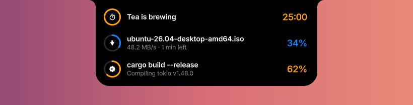
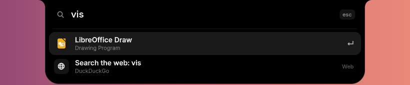
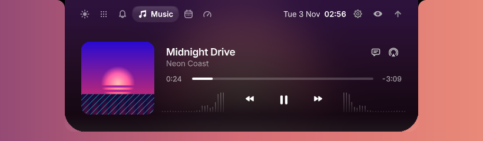
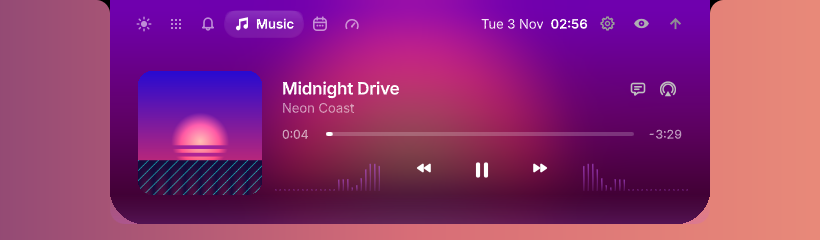
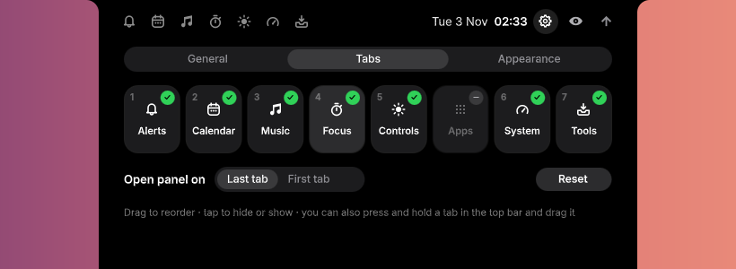
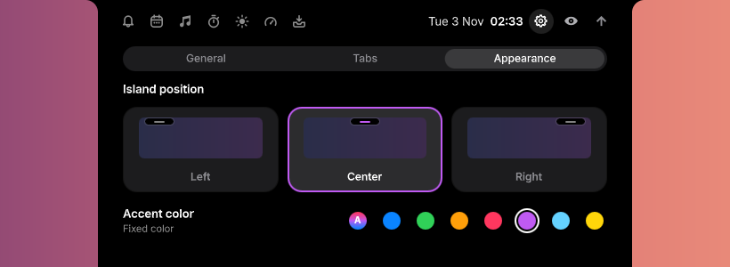
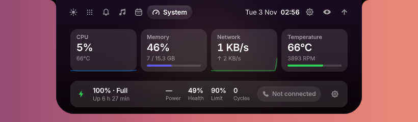
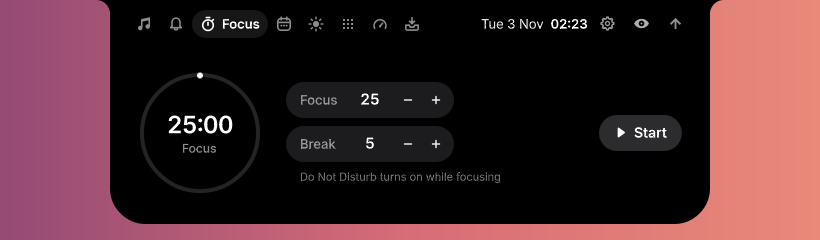
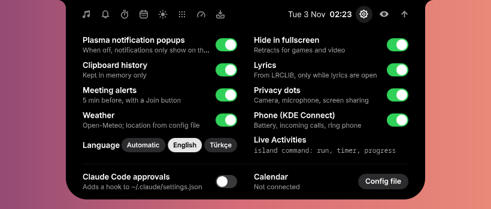

<div align="center">

# Dynamic Island for KDE Plasma

**A living notch for your Linux desktop.** Music, notifications, calendar, focus timer, quick controls —
and **Live Activities** any script can drive from the terminal.

**English** · [Türkçe](README.tr.md)

[](https://github.com/nailhakan/dynamic-island/actions/workflows/ci.yml)




</div>

---

## Live Activities: your terminal, on the island

Wrap any command and watch it on the island while you do something else. When it finishes you get a ✓ or a ✗,
the time it took, and the exit code is passed through unchanged, so it works in scripts and CI too.

```bash
island run -- cargo build --release      # live while it runs, ✓ / ✗ when done
island timer 25m Tea                     # countdown with a chime
island progress backup 42% -t "Backup" -i upload
island notify "Deploy finished" "v2.4.1 is live"
```

<p align="center">
  <br>
  <br>
  
</p>

**Never babysit a terminal again.** One line in your shell config and every command that runs longer than
10 seconds reports back to the island when it ends:

```bash
eval "$(island hook zsh)"     # ~/.zshrc
eval "$(island hook bash)"    # ~/.bashrc
island hook fish | source     # ~/.config/fish/config.fish
```

Tune the threshold with `ISLAND_MIN_SECS`. Interactive tools (`vim`, `ssh`, `htop`…) are skipped.

Activities have a progress ring (or a spinner when progress is unknown), a value, a subtitle, an icon and
a colour. Hover the island to see the three newest; hover a row to cancel it. In hidden mode, a running
activity still shows as a hairline progress bar on the screen edge.

### From any language

The island is a small local HTTP API, so anything that can `POST` JSON can drive it:

```python
import json, os, urllib.request

token = open(os.path.join(os.environ["XDG_RUNTIME_DIR"], "dynamic-island", "token")).read().strip()
def island(**body):
    req = urllib.request.Request("http://127.0.0.1:47615/activity", json.dumps(body).encode(),
                                 {"X-Island": token, "Content-Type": "application/json"})
    return json.load(urllib.request.urlopen(req))

island(op="set", id="render", title="Rendering scene", progress=0.3, icon="build")
island(op="end", id="render", state="done", message="4K · 2 min 10 s")
```

| op | fields |
|---|---|
| `set` | `id`, `title`, `subtitle`, `progress` (0–1, `"42%"`, or `-1` for a spinner), `value`, `icon`, `color` (`#rrggbb`), `duration` (`"5m"`), `end` (epoch ms), `ttl` (s) |
| `end` | `id`, `state` (`done` · `failed` · `cancelled`), `message` |
| `notify` | `title`, `body`, `icon`, `color` |
| `list` · `clear` | — |

Built-in icons: `build` `download` `upload` `timer` `test` `deploy` `sync` `terminal` `music` `mail` `check`
`warning`, or any freedesktop icon name. The token file is readable only by you, and the server listens on
`127.0.0.1` only and refuses browser requests.

## Command palette

Press **Meta+Alt+Space** (or run `island palette`) and the island becomes a search field: everything
KRunner does, inside the island. `↑` `↓` to choose, `Enter` to run, `Esc` to close.

| Type | Get |
|---|---|
| `fire`, `vsc` | apps (fuzzy, the ones you use most rise to the top) |
| `thunder` | open **windows** and **browser tabs / history** (KRunner's D-Bus plugins) |
| `report` | files: Baloo, plocate, or a built-in in-memory index when neither sees your home folder |
| `15%*240` · `10 km in mi` · `72 f to c` | calculator and unit conversion |
| `5m tea` | a timer, live on the island |
| `gg: kde` `yt:` `wp:` `gh:` `aur:` `aw:` `so:` `map:` `tr:` | web shortcuts |
| `~/Projects` · `github.com/kde` | open folders, files and URLs |
| `> htop` · `>> cmd` | run in a terminal / in the background |
| `kill firefox` | end a process (asks you to press Enter again) |
| `restart` · `shut down` · `log out` · `lock` | session actions (destructive ones need a second Enter) |
| `display`, `bluetooth` | System Settings pages |
| `time tokyo` · `date` | world clock, week number |
| `#0a84ff` · `u:heart` · `#2192` | colour formats, Unicode and emoji |
| recent documents, browser bookmarks, Konsole profiles, clipboard history, island commands and tabs | |

Prefer it on Alt+Space? Move KRunner to Alt+F2 in System Settings → Shortcuts and give Alt+Space to
"Dynamic Island: Command palette".

<p align="center">
  
</p>

## Designed to disappear

Three materials in **Settings → Appearance**:

- **Minimal** (default): deep black with a whisper of the album's colour, a hairline rim light and
  frosted-glass cards. Quiet depth instead of decoration.
- **Ambient**: the album artwork floods the panel; light breathes with the music in your accent colour.
- **Classic black**: a plain notch.

The music bars are **real**: a pure-Python FFT of what your speakers are playing, analysed in memory
only and only while the bars are on screen. Tab changes use **liquid motion**: the selection pill
stretches toward its target like a droplet, contracts and settles with a soft wobble, while the next page
slides in out of a light blur.

<p align="center">
  <br>
  
</p>

## Make it yours

Press and hold any tab in the panel and drag it, iOS-style: the others slide out of the way and the new
order is saved when you let go. **Settings → Tabs** lets you reorder, hide the tabs you never use and
choose whether the panel opens on the last or the first tab. **Settings → Appearance** moves the island to
the left, centre or right of the screen and sets the accent colour: taken from the playing album's
artwork, or fixed.

<p align="center">
  <br>
  
</p>

## Everything else

<p align="center">
  
</p>

- **Music:** any MPRIS player, artwork-tinted accent colour, seek bar, output device picker,
  **synced lyrics** ([LRCLIB](https://lrclib.net)) — tap a line to jump there
- **Notifications:** Plasma notifications land on the island. Tap one and the app opens **straight to that
  chat, email or tab** (the notification's default action), with Do Not Disturb built in
- **Claude Code approvals:** permission prompts show up on the island — Deny / Allow / Always —
  and you're told when the agent is done (`./install-claude-hooks.sh`)
- **Calendar:** iCal/.ics URLs and CalDAV (Apple iCloud, Nextcloud), add events in plain language
  ("Dinner 20:00"), meeting alerts 5 minutes before with a **Join** button (Meet, Zoom, Teams, Webex…)
- **Focus timer (Pomodoro)** with a ring on the closed island and automatic Do Not Disturb
- **Controls:** volume, per-monitor brightness (DDC/CI), Night Light, Wi-Fi, Bluetooth, power profile
- **System:** CPU, memory, network, temperature/fan, battery health, weather (Open-Meteo, no key),
  your phone's battery via KDE Connect, incoming call alerts
- **Privacy dots:** camera (green), microphone (orange), screen sharing (blue)
- **Alerts:** Caps Lock, Bluetooth devices with battery level, internet lost/back, charging, low battery
- **Tools:** clipboard history with search and a built-in calculator, reminders, notes, a drag-and-drop
  file shelf, screen recording
- **English and Turkish UI**, following your system language (Settings → Language)

<p align="center">
  <br>
  
</p>

## Install

Requirements: KDE Plasma 6 on Wayland, `qml6`, `layer-shell-qt`, Kirigami, Python 3 with PyGObject and
dbus-python, `kscreen-doctor`, `nmcli`, `wpctl`/`pactl`. Optional: `kdeconnect`, `ffmpeg`, `spectacle`,
`bluez-utils`, `libsecret`.

```bash
git clone https://github.com/nailhakan/dynamic-island
cd dynamic-island
./install.sh          # systemd user service + `island` in ~/.local/bin
```

**Arch / CachyOS:** `makepkg -si` in the repo, then `systemctl --user enable --now dynamic-island`.

Run it without installing: `./launch.sh` (stop with `./stop.sh`).

## Use

| | |
|---|---|
| Click | open / close the panel |
| Right click | mute (closes a banner) |
| Scroll | volume |
| Drop a file | put it on the shelf |
| `Meta+Alt+I` | panel · `Meta+Alt+H` hide · `Meta+Alt+D` Do Not Disturb · `Meta+Alt+R` record |

```bash
island panel | toggle | hide | show | dnd | record | play-pause | next | prev | focus
island tab calendar          # open the panel on a tab (music, notifications, focus, calendar, …)
```

Settings live in `~/.config/dynamic-island/config.json` (the gear icon on the island toggles most of them).

<details>
<summary>Apple iCloud calendar</summary>

1. account.apple.com → Sign-In and Security → App-Specific Passwords
2. `secret-tool store --label="Dynamic Island iCloud" service dynamic-island account icloud`
3. In `config.json`:

```json
"caldav": [{
  "name": "iCloud",
  "url": "https://caldav.icloud.com",
  "user": "your-apple-id@icloud.com",
  "password_cmd": "secret-tool lookup service dynamic-island account icloud"
}]
```
</details>

## How it works

```
 island CLI / scripts ──POST /activity──┐
 Claude Code hook ─────POST /agent/*────┤
                                        ▼
 D-Bus (MPRIS, notifications, KWin) ─► backend.py ──long-poll /state (deltas)──► QML island (layer-shell)
 PipeWire, NetworkManager, CalDAV  ─►  127.0.0.1:47615                      ◄── POST /cmd
```

- `backend.py`: event-driven state server; only changed keys are sent to the UI
- `activities.py` + `island`: Live Activities and the command-line tool (no dependencies)
- `contents/ui/`: the island and panel (`main.qml`), pages (`Page*.qml`), translations (`lang_en.js`)
- `i18n.py`: translations for the backend and CLI
- `tests/`: `python -m unittest discover -s tests -t .` and `qmltestrunner -input tests/qml`
  (drag-to-reorder, with simulated mouse input)

Want another language? Copy `contents/ui/lang_en.js` to `lang_xx.js`, translate the values, and add it
to `dicts` in `main.qml`. See [CONTRIBUTING.md](CONTRIBUTING.md).

## License

GPL-3.0. Icons come from the Isle project (GPL-3.0, see `contents/icons/LICENSE-isle-GPL3.txt`).
